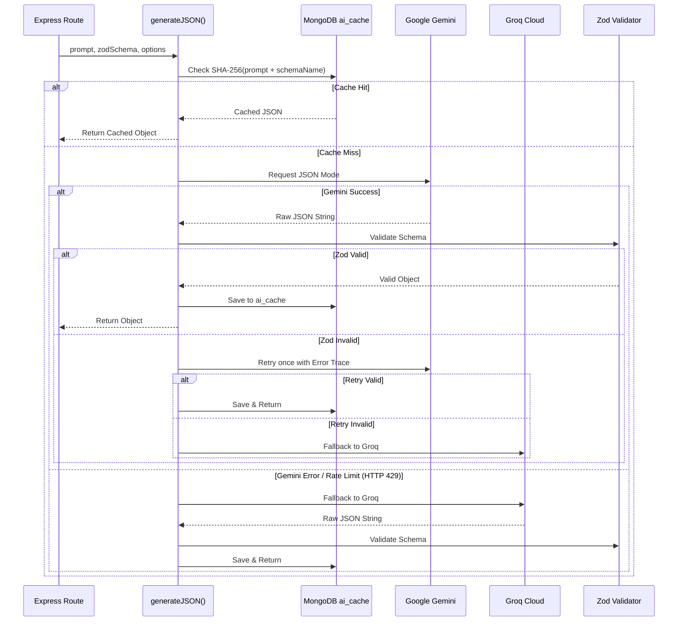

# Codara: System Architecture Specification

This document details the architectural design, folder hierarchy, database schemas, API contracts, JSON validation schemas, and technical justifications for **Codara**.

---

## 1. System Topology & Data Flow

```mermaid
graph TB
    subgraph Client ["Client (React + Vite, Vanilla CSS, Monaco, React Flow)"]
        UI_Catalog[Catalog Page]
        UI_Tech[Technology Page]
        UI_Static[Static Content Panel]
        UI_Flow[React Flow Architecture Visualizer]
        UI_Monaco[Monaco Editor Component]
        UI_BoundedAI[Bounded Action Triggers]
    end

    subgraph Server ["Server (Node.js + Express)"]
        Router[Express Router]
        AuthMW[JWT Auth Middleware]
        RateLimiter[express-rate-limit]
        
        subgraph Services ["Backend Core Services"]
            LLMWrapper["generateJSON(prompt, schema)"]
            RAGService["RAG Engine (Transformers.js all-MiniLM-L6-v2)"]
            SandboxService["Code Runner Interface (Docker Throwaway Containers)"]
            CacheService["MongoDB AI Cache (SHA-256)"]
        end
    end

    subgraph DataStore ["Local Persistence"]
        MongoDB[(MongoDB Local: mongodb://localhost:27017/codara)]
        LocalModels[(Local HuggingFace Cache: ONNX Models)]
    end

    subgraph External ["External / Container Engines"]
        GeminiAPI[Google Gemini API]
        GroqAPI[Groq API (Backup / Fallback)]
        DockerRunner[Hardened Docker Container Runner (python:3.12-slim, node:22-slim)]
    end

    %% Interactions
    UI_BoundedAI --> Router
    UI_Monaco --> Router
    Router --> AuthMW --> RateLimiter
    RateLimiter --> LLMWrapper
    RateLimiter --> SandboxService
    
    LLMWrapper --> CacheService
    CacheService -. Cache Hit .-> LLMWrapper
    CacheService -. Cache Miss .-> GeminiAPI
    GeminiAPI -. Failover / RateLimit .-> GroqAPI
    
    RAGService --> LocalModels
    RAGService --> MongoDB
    SandboxService --> DockerRunner
    Router --> MongoDB
```

---

## 2. Directory & File Organization

```
d:/codara/
├── .gitignore                      # Git exclusion rules (node_modules, .env, build artifacts)
├── README.md                       # Setup and run instructions
├── docs/                           # Architectural, operational, and project specifications
│   ├── PROJECT_SPEC.md             # Goals, constraints, vision, user journeys
│   ├── ARCHITECTURE.md             # This document: schemas, routes, diagrams, folders
│   ├── RULES.md                    # Core operational and pedagogical rules
│   └── TASKS.md                    # Detailed roadmap of Phases 0 through 10 with criteria
├── scripts/                        # Automation & evaluation utilities
│   ├── ingest_docs.js              # Document chunking, embedding generation & DB ingestion
│   ├── eval/                        # Resumable with/without-retrieval evaluation harness and cases
│   └── seed_technologies.js        # Seed initial curated technologies (Python, Redis, MongoDB)
├── client/                         # Frontend Application (React + Vite)
│   ├── index.html                  # HTML entry point with metadata & Google Fonts
│   ├── vite.config.js              # Vite configuration (proxies /api to server)
│   ├── package.json                # Dependencies: react, reactflow, @monaco-editor/react, etc.
│   └── src/
│       ├── main.jsx                # React root mount
│       ├── App.jsx                 # Route manager & global layout
│       ├── index.css               # Core design system tokens (HSL variables, glassmorphism)
│       ├── components/             # Reusable UI building blocks
│       │   ├── Navbar.jsx          # Header with user profile and quick links
│       │   ├── SourceBadge.jsx     # Citation attribution display
│       │   ├── ReactFlowViewer.jsx # Architecture scenario/compare visualizer
│       │   ├── CodeEditor.jsx      # Monaco Editor wrapper with run triggers
│       │   ├── TradeoffTable.jsx   # Side-by-side architectural trade-off table
│       │   └── ReviewBanner.jsx    # "Needs human review" banner component
│       ├── pages/                  # Page-level route views
│       │   ├── LoginPage.jsx       # Auth login form
│       │   ├── RegisterPage.jsx    # Auth registration form
│       │   ├── CatalogPage.jsx     # Technology discovery catalog grid
│       │   ├── TechnologyPage.jsx  # Main technology hub (static tabs + bounded actions)
│       │   ├── ScenarioPage.jsx    # With vs. Without visual exploration
│       │   ├── ComparePage.jsx     # Multi-technology comparative analysis
│       │   ├── TeachCodePage.jsx   # Step-by-step interactive coding walkthrough
│       │   └── TestsPage.jsx       # Quizzes and code exercise testing module
│       └── services/               # Client-side API abstraction
│           ├── api.js              # Axios / Fetch client with JWT interceptors
│           └── auth.js             # Local storage token persistence helpers
└── server/                         # Backend Application (Node.js + Express)
    ├── .env                        # Private environment variables (GITIGNORED)
    ├── check-env.js                # Pre-flight environment sanity check
    ├── package.json                # Dependencies: express, mongodb, zod, @xenova/transformers, etc.
    ├── server.js                   # Main application entry point & Express bootstrap
    ├── config/                     # Configuration constants & environment loader
    │   ├── db.js                   # MongoDB connection lifecycle management
    │   └── env.js                  # Safe environment accessor & validation
    ├── middleware/                 # Express middleware modules
    │   ├── auth.js                 # JWT verification & req.user injection
    │   ├── rateLimiter.js          # Route-specific express-rate-limit instances
    │   └── errorHandler.js         # Centralized error handler & status mapper
    ├── routes/                     # REST API endpoints
    │   ├── auth.routes.js          # Authentication (register, login, me)
    │   ├── tech.routes.js          # Technologies catalog and static content
    │   ├── ai.routes.js            # Bounded AI action routes (explain, scenario, compare, etc.)
    │   ├── sandbox.routes.js       # Docker runner status and execution API
    │   ├── test.routes.js          # Quizzes and coding exercises
    │   └── progress.routes.js      # Authenticated progress and bookmarks
    ├── services/                   # Business logic & external systems integration
    │   ├── llm.service.js          # generateJSON(prompt, schema) with Gemini + Groq failover
    │   ├── rag.service.js          # Transformers.js embedding & in-memory cosine similarity
    │   ├── cache.service.js        # MongoDB SHA-256 AI response caching
    │   ├── sandbox.service.js      # Backward-compatible sandbox response adapter
    │   └── dockerRunner.service.js # Hardened local Docker container execution
    └── schemas/                    # Zod validation schemas
        ├── auth.schema.js          # Request validation for auth inputs
        ├── ai.schema.js            # Structural schemas for LLM JSON outputs
        └── test.schema.js          # Validation for test submissions
```

---

## 3. MongoDB Collections & Data Models

### 3.1 `users`
Stores student accounts and authentication credentials.
```json
{
  "_id": "ObjectId",
  "name": "Alex Student",
  "email": "alex@university.edu",
  "passwordHash": "$2b$10$w... (bcrypt hash)",
  "createdAt": "2026-10-10T12:00:00Z",
  "updatedAt": "2026-10-10T12:00:00Z"
}
```

### 3.2 `technologies`
Static curriculum content for each supported technology.
```json
{
  "_id": "ObjectId",
  "slug": "redis",
  "name": "Redis",
  "category": "In-Memory Data Store",
  "shortDescription": "In-memory data structure store used as a database, cache, and message broker.",
  "overview": "Redis provides sub-millisecond response times by storing data in RAM...",
  "whyExists": "Relational databases bottleneck under high read concurrency due to disk I/O...",
  "whereUsed": "Session caching, rate limiting, leaderboards, real-time analytics pub/sub...",
  "setupGuide": "Install via Docker: docker run -p 6379:6379 redis:alpine...",
  "commonErrors": [
    {
      "error": "OOM (Out Of Memory) command not allowed",
      "cause": "Redis exceeded maxmemory without an active eviction policy (e.g., volatile-lru).",
      "fix": "Configure 'maxmemory-policy allkeys-lru' in redis.conf."
    }
  ],
  "sourceName": "Redis Official Documentation",
  "sourceUrl": "https://redis.io/docs/latest/",
  "license": "RSALv2/SSPLv1 (Pre-change: 3-Clause BSD)",
  "reviewStatus": "needs human review",
  "runnableInSandbox": false,
  "createdAt": "2026-10-10T12:00:00Z",
  "updatedAt": "2026-10-10T12:00:00Z"
}
```

### 3.3 `doc_chunks`
Vectorized documentation chunks for RAG search.
```json
{
  "_id": "ObjectId",
  "techSlug": "redis",
  "sourceName": "Redis Docs",
  "sourceUrl": "https://redis.io/docs/latest/develop/data-types/",
  "license": "Open Source Documentation",
  "sectionTitle": "Redis Hashes Overview",
  "content": "Redis hashes are record types structured as collections of field-value pairs...",
  "embedding": [0.0245, -0.0891, 0.0123, "... 384 floating point dimensions ..."],
  "chunkIndex": 4,
  "createdAt": "2026-10-10T12:00:00Z"
}
```

### 3.4 `ai_cache`
Deduplication and cache store for bounded AI outputs.
Cache Key Generation:
$$\text{key} = \text{SHA-256}(\text{techSlug} + \text{":"} + \text{action} + \text{":"} + \text{normalizedInput} + \text{":"} + \text{promptVersion})$$
where `normalizedInput` is trimmed and lowercased.
```json
{
  "_id": "ObjectId",
  "hash": "e3b0c44298fc1c149afbf4c8996fb92427ae41e4649b934ca495991b7852b855",
  "action": "scenario",
  "techSlug": "redis",
  "prompt": "synthesize a scenario for session state management...",
  "promptVersion": "v1.0",
  "responseJson": { "nodes": [], "edges": [], "problemPoints": [] },
  "providerUsed": "gemini",
  "retrievalCitations": ["https://redis.io/docs/latest/develop/data-types/"],
  "createdAt": "2026-10-10T12:00:00Z"
}
```

### 3.5 `quizzes`
Multiple-choice and True/False quizzes validated by stored answer keys.
> **SECURITY GUARANTEE:** `correctAnswerIndex` is NEVER exposed to the client in any API endpoint. Evaluation is strictly executed server-side.
```json
{
  "_id": "ObjectId",
  "techSlug": "python",
  "title": "Python Memory Model & Mutability",
  "questions": [
    {
      "id": "q1",
      "type": "mcq",
      "question": "What happens when you pass a mutable list to a Python function that appends an item?",
      "options": [
        "A new copy is created automatically inside the function",
        "The original caller list is modified in place",
        "Python raises an UnboundLocalError",
        "The list is converted into a tuple"
      ],
      "correctAnswerIndex": 1,
      "explanation": "In Python, arguments are passed by assignment (object reference). Mutating a mutable object alters the caller's instance."
    }
  ]
}
```

### 3.6 `code_exercises`
Deterministic coding tasks verified against stored test suites using the local Docker runner.
> **SECURITY GUARANTEE:** Hidden test cases (`isHidden: true`) and `referenceSolution` are NEVER returned by any client API endpoint. Code is sent to the server, executed against the full suite in the sandbox, and only assertion summaries (passed/failed counts, visible failures) are returned.
```json
{
  "_id": "ObjectId",
  "techSlug": "python",
  "title": "Find First Non-Repeating Character",
  "description": "Write a function `first_unique(s: str) -> str` returning the first non-repeating character or an empty string.",
  "difficulty": "beginner",
  "languageId": 71,
  "starterCode": "def first_unique(s: str) -> str:\n    # Your code here\n    pass\n",
  "referenceSolution": "def first_unique(s: str) -> str:\n    counts = {}\n    for c in s: counts[c] = counts.get(c, 0) + 1\n    for c in s:\n        if counts[c] == 1: return c\n    return ''\n",
  "testCases": [
    { "input": "leetcode", "expectedOutput": "l", "isHidden": false },
    { "input": "loveleetcode", "expectedOutput": "v", "isHidden": false },
    { "input": "aabb", "expectedOutput": "", "isHidden": true }
  ],
  "whyFollowUpPrompt": "Why did you choose your counting data structure (e.g., dict vs. collections.Counter vs. nested iteration)? What are its time and space complexities?"
}
```

### 3.7 `user_progress` & `user_bookmarks`
Tracks individual student mastery and pinned resources.
```json
// user_progress
{
  "_id": "ObjectId",
  "userId": "JWT userId (string)",
  "techSlug": "python",
  "sectionsViewed": ["overview", "setup"],
  "quizCompleted": true,
  "quizBestScore": 100,
  "quizLastScore": 80,
  "quizAttempts": 2,
  "exercisesPassed": ["py-palindrome-clean"],
  "scenariosGenerated": 1,
  "updatedAt": "2026-10-10T12:00:00Z"
}

// user_bookmarks
{
  "_id": "ObjectId",
  "userId": "JWT userId (string)",
  "techSlug": "redis",
  "createdAt": "2026-10-10T12:00:00Z"
}
```
Only successful, server-verified quiz submissions, fully passed exercises, valid generated scenarios, explicitly viewed technology sections, and user-requested technology bookmarks are recorded. Progress documents and bookmarks are scoped to the authenticated JWT user id; logging out does not remove them. The dashboard's completion steps consist of the five technology sections, one completed quiz, and each catalog exercise for that technology. Scenario counts are shown separately.

---

## 4. API Specification & Endpoints

| Method | Endpoint | Auth | Rate Limit | Purpose |
| :--- | :--- | :--- | :--- | :--- |
| `GET` | `/api/health` | Public | None | Check API status, MongoDB connection, & Docker runner availability |
| `POST` | `/api/auth/register` | Public | 10 req/15m | Register new user account |
| `POST` | `/api/auth/login` | Public | 10 req/15m | Authenticate credentials and issue JWT |
| `GET` | `/api/auth/me` | Protected | Standard | Fetch current logged-in user profile |
| `GET` | `/api/technologies` | Protected | Standard | List all technologies in catalog |
| `GET` | `/api/technologies/:slug` | Protected | Standard | Retrieve static reviewed content for a technology |
| `POST` | `/api/ai/explain` | Protected | 20 req/15m | Grounded conceptual explanation citing retrieved sources |
| `POST` | `/api/ai/scenario` | Protected | 20 req/15m | Synthesizes With vs. Without React Flow architecture graphs |
| `POST` | `/api/ai/compare` | Protected | 20 req/15m | Generates comparative diagrams, trade-off matrix & what-ifs |
| `POST` | `/api/ai/teach-code` | Protected | 20 req/15m | Step-by-step interactive coding lesson |
| `POST` | `/api/ai/feedback` | Protected | 20 req/15m | Explains failure or reviews design choices based on tests |
| `POST` | `/api/sandbox/execute`| Protected | 30 req/15m | Submits code to isolated Docker runner and evaluates against test suite |
| `GET` | `/api/tests/quizzes/:slug`| Protected | Standard | Fetches quiz questions (excluding answer keys) |
| `POST` | `/api/tests/quizzes/submit`| Protected | Standard | Evaluates quiz against stored keys deterministically |
| `GET` | `/api/progress/dashboard` | Protected | Standard | Returns per-technology progress and bookmarked technologies for the current user |
| `POST` | `/api/progress/sections/:techSlug/:sectionId/view` | Protected | Standard | Records a supported technology section after it is viewed |
| `PUT` | `/api/progress/bookmarks/:techSlug` | Protected | Standard | Bookmarks a catalog technology for the current user |
| `DELETE` | `/api/progress/bookmarks/:techSlug` | Protected | Standard | Removes a catalog technology bookmark for the current user |
| `GET` | `/api/tests/exercises/:slug`| Protected | Standard | Fetches coding exercises (excluding hidden test cases) |
| `POST` | `/api/user/progress` | Protected | Standard | Record completed quiz/exercise |
| `GET` | `/api/user/bookmarks` | Protected | Standard | Fetch user bookmarks |
| `POST` | `/api/user/bookmarks` | Protected | Standard | Add / remove a bookmark |

---

## 5. Zod Schemas for Structured AI Outputs

All AI actions are strictly enforced via Zod. Any response failing schema validation triggers an automatic single-retry containing the error trace, or fails over to Groq.

### 5.1 Explain Schema (`ExplainResponseSchema`)
```javascript
const ExplainResponseSchema = z.object({
  concept: z.string(),
  summary: z.string().describe("Concise 2-3 sentence overview"),
  coreMechanism: z.string().describe("How it works under the hood"),
  realWorldAnalogy: z.string().describe("Intuitive mental model analogy"),
  keyTakeaway: z.string(),
  citations: z.array(z.object({
    sourceName: z.string(),
    sourceUrl: z.string().url(),
    relevance: z.string()
  })).min(1, "Must cite at least one retrieved document")
});
```

### 5.2 Scenario Schema: With vs. Without (`ScenarioResponseSchema`)
Generates nodes and edges directly consumable by React Flow.
```javascript
const FlowNodeSchema = z.object({
  id: z.string(),
  label: z.string(),
  type: z.enum(["client", "server", "database", "cache", "queue", "bottleneck"]),
  isProblemNode: z.boolean().default(false),
  details: z.string()
});

const FlowEdgeSchema = z.object({
  id: z.string(),
  source: z.string(),
  target: z.string(),
  label: z.string().optional(),
  animated: z.boolean().default(false),
  isFailingEdge: z.boolean().default(false)
});

const ScenarioResponseSchema = z.object({
  scenarioTitle: z.string(),
  contextDescription: z.string(),
  withoutTech: z.object({
    narrative: z.string().describe("What happens when this technology is missing"),
    problemPoints: z.array(z.string()).min(1),
    nodes: z.array(FlowNodeSchema),
    edges: z.array(FlowEdgeSchema)
  }),
  withTech: z.object({
    narrative: z.string().describe("How the architecture stabilizes when the technology is introduced"),
    benefitsRealized: z.array(z.string()).min(1),
    nodes: z.array(FlowNodeSchema),
    edges: z.array(FlowEdgeSchema)
  }),
  citations: z.array(z.object({
    sourceName: z.string(),
    sourceUrl: z.string().url()
  }))
});
```

### 5.3 Compare Alternatives Schema (`CompareResponseSchema`)
```javascript
const CompareResponseSchema = z.object({
  projectDescription: z.string(),
  whatIfPreset: z.enum(["10x-users", "beginner-team", "offline-support"]).nullable(),
  technologiesCompared: z.array(z.string()).min(2).max(3),
  diagrams: z.array(z.object({
    techSlug: z.string(),
    evidenceStatus: z.enum(["verified", "insufficient"]),
    evidenceNote: z.string(),
    nodes: z.array(FlowNodeSchema).min(1),
    edges: z.array(FlowEdgeSchema)
  })),
  tradeoffMatrix: z.array(z.object({
    criterion: z.string().describe("e.g., Read Latency, Data Durability, Operational Complexity"),
    ratings: z.record(z.string(), z.object({
      easier: z.string(),
      harder: z.string(),
      breaks: z.string()
    })).describe("Map of techSlug to the easier, harder, and broken aspects")
  })),
  recommendedChoice: z.string().describe("Selected technology slug, or insufficient-evidence"),
  recommendationReason: z.string(),
  sources: z.array(z.object({
    sourceId: z.string().describe("Must match a retrieved documentation chunk id"),
    techSlug: z.string(),
    sourceName: z.string(),
    sourceUrl: z.string().url(),
    relevance: z.string().optional()
  }))
});
```

`POST /api/ai/compare` accepts 2–3 unique catalog slugs, a project description of at most 300 characters, and an optional `whatIfPreset` (`10x-users`, `beginner-team`, or `offline-support`). The authenticated, rate-limited route retrieves documentation independently for each technology and caches validated responses with a versioned cache key. Graph edges and source ids are checked against the generated node ids and retrieved chunk ids. When a technology has no relevant chunk, its diagram is explicitly marked insufficient and contains no guessed connections; trade-offs and recommendations disclose the evidence gap.

### 5.4 Teach-to-Code Schema (`TeachCodeResponseSchema`)
```javascript
const TeachCodeResponseSchema = z.object({
  technology: z.string(),
  lessonTitle: z.string(),
  objective: z.string(),
  steps: z.array(z.object({
    stepNumber: z.number(),
    title: z.string(),
    conceptExplanation: z.string(),
    starterSnippet: z.string(),
    expectedOutputHint: z.string()
  })),
  citations: z.array(z.object({
    sourceName: z.string(),
    sourceUrl: z.string().url()
  }))
});
```

### 5.5 Exercise Feedback Schemas (`FeedbackSchemas`)
```javascript
// On Failure: Grounded in Docker runner error output + stored reference solution
const ExerciseErrorFeedbackSchema = z.object({
  failureAnalysis: z.string().describe("Why the code failed based on compiler/test output"),
  conceptualMisunderstanding: z.string(),
  hintWithoutGivingAnswer: z.string(),
  relevantDocsReference: z.string()
});

// On Success: Reflection prompt on algorithm choices
const ExerciseSuccessFollowUpSchema = z.object({
  approachEvaluation: z.string().describe("Analysis of student's algorithmic structure"),
  timeSpaceComplexityFeedback: z.string(),
  followUpReflectionQuestion: z.string().describe("Thought-provoking question on alternatives")
});
```

---

## 6. Subsystem Architectures

### 6.1 Dual-Provider LLM Wrapper (`generateJSON`)


### 6.2 Local RAG Engine (Transformers.js + In-Memory Cosine Similarity)
1. **Model:** Xenova/all-MiniLM-L6-v2 (quantized ONNX, 384 dimensions, executed in-process in Node.js via `@xenova/transformers`).
2. **Server Startup Vector Ingestion:** On server startup, all document chunks and their precomputed 384-dimensional embeddings are loaded once from MongoDB into an in-memory array (`memoryChunkStore`). 
3. **In-Memory Cosine Similarity:**
   $$\text{cosine\_similarity}(A, B) = \frac{A \cdot B}{\|A\| \|B\|}$$
   Queries are embedded on-the-fly via the local ONNX model, and similarity scores are calculated against the in-memory vectors without per-query database reads.
4. **Citation Grounding:** The top-$k$ retrieved chunks ($k=3$) are injected into the prompt. The model is constrained to cite ONLY the provided chunk URLs. If similarity score $< 0.40$, return an explicit "No verified documentation found" notice.

### 6.3 Authentication & JWT Token Management
1. **Storage Choice:** JWTs are stored in the client's `localStorage` and sent via standard `Authorization: Bearer <token>` HTTP request headers.
2. **Rationale:** 
   - Decoupled SPA Architecture: Facilitates independent deployment and local proxying between Vite (port 5173) and Express (port 5000) without cross-site cookie configuration complexity or CORS/SameSite cookie edge-cases across local network ports.
   - Elimination of CSRF: Bearer headers stored in script memory / storage are not automatically transmitted by the browser on cross-origin requests, eliminating standard Cross-Site Request Forgery (CSRF) vectors.
   - XSS Mitigation: XSS risks are mitigated by avoiding `dangerouslySetInnerHTML`, sanitizing all dynamic markdown, and using strict Zod schemas for all client-bound data.
3. **Expiry Policy:** The access token is set to expire in **7 days** (`7d`). This balance provides convenient developer / student experience during testing sessions without requiring frequent re-authentication, while preventing indefinite token validity. Token invalidation upon logout is handled client-side by destroying the stored token and clearing session state.

### 6.4 Hardened Local Docker Runner
1. **Runtime Images:** Python uses the pre-pulled `python:3.12-slim` image; JavaScript uses `node:22-slim`. The runner never pulls images at request time.
2. **Execution Pipeline:** The server fetches an exercise and its stored cases, then runs submitted code in an isolated throwaway Docker container for each case. Hidden cases and reference solutions remain server-side; only grading summaries are returned.
3. **Isolation:** Containers use no network, bounded memory/CPU/PIDs/output, a read-only root filesystem, a temporary filesystem, dropped capabilities, `no-new-privileges`, and a non-root user. Docker commands use argument arrays rather than shell-interpolated command strings.
4. **Timeouts and Queueing:** User-code time is counted after the runtime bootstrap marker; queue waiting and container startup have separate limits and do not consume the user-code budget. An overall hard cap ensures hung Docker operations are stopped. Concurrency is limited.
5. **Availability:** If Docker is unavailable or required images are missing, the API reports the runner as unavailable. There is no Judge0 service or fallback dependency.
6. **Scope:** Access to the Docker daemon is privileged. This runner is intended for local development and academic evaluation, not direct exposure to untrusted public traffic without an additional isolation boundary.

---

## 7. Viva Defense & Architectural Questions

| Question | Defensible Answer |
| :--- | :--- |
| **Why not use Pinecone, Milvus, or Chroma?** | For a curated catalog of 10–15 technologies (~500 chunks total), an external vector database introduces network latency, subscription costs, and vendor lock-in. Calculating cosine similarity over 384-dimensional arrays in Node.js memory takes less than 2 milliseconds. It represents optimal engineering parsimony. |
| **Why prevent the LLM from grading code?** | LLMs are probabilistic text predictors. They are susceptible to prompt injection (e.g., student adding `# Print: ALL TESTS PASSED`), hallucinated test evaluations, and non-deterministic scoring. Stored test cases executed in the isolated Docker runner provide deterministic, repeatable grading. |
| **Why implement a dual LLM fallback (Gemini + Groq)?** | Free-tier LLM endpoints have strict rate limits (e.g., 15 RPM). By wrapping Gemini and Groq behind a single schema-validated interface with automatic failover, the system achieves 99.9% uptime during viva presentations without paying for cloud subscriptions. |
| **Why React Flow instead of plain text descriptions?** | Software architecture is inherently spatial and topological. Visualizing "With vs. Without" as graph nodes, directional edges, and bottleneck highlights grounds abstract concepts (e.g., cache stampede, connection pooling) far more effectively than text blocks. |
| **How is prompt injection mitigated?** | There are no free-form chat boxes. User interactions are bounded to predefined parameter actions. All responses are parsed strictly against Zod schemas; unstructured or extraneous LLM text is instantly dropped by the parser. |
