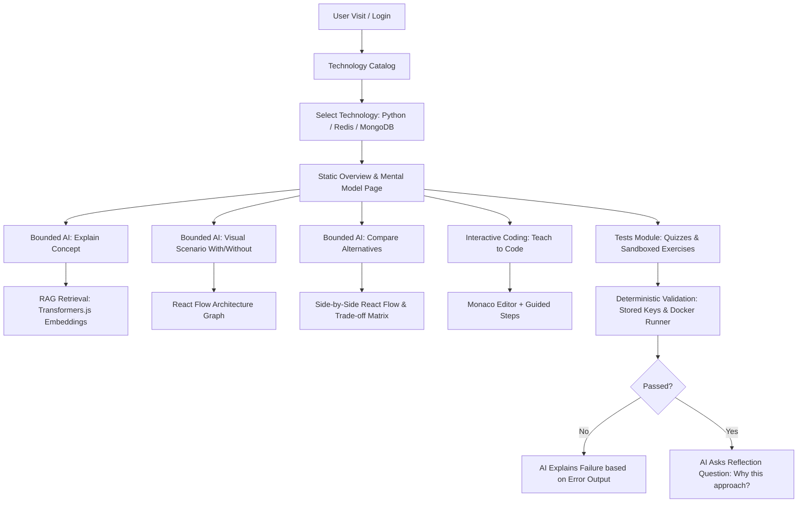

# Codara: Project Specification

> **Tagline:** Discover. Understand. Code.  
> **Project Type:** College Full-Stack + Bounded AI Learning Platform  
> **Target Environment:** Localhost (Windows 11, `D:\codara`)

---

## 1. Executive Summary & Vision

**Codara** is an educational engineering platform designed to teach modern programming technologies through a **purpose-first, bounded pedagogical methodology**. 

Traditional learning platforms often suffer from two extremes:
1. **Passive static documentation** that lacks interactive visualization and context-driven feedback.
2. **Open-ended chatbot assistants** that hallucinate, act as crutches, drift off-topic, or provide non-deterministic grading.

Codara solves this by enforcing an opinionated learning workflow:
- **Phase 1: Discover & Understand (Static First):** When a user logs in, they are **never** greeted by a conversational bot. Instead, they access a curated Technology Catalog (target: 10–15 technologies; initial seed: **Python**, **Redis**, **MongoDB**). Each technology page presents vetted static content answering: *What is it? Why does it exist? Where is it used? How is it set up? What are common beginner pitfalls?*
- **Phase 2: Explore Context & Architecture (Bounded AI):** AI capabilities are strictly compartmentalized into deterministic, bounded actions with structured visual outputs:
  - **Explain:** Grounded conceptual clarification citing retrieved documentation chunks.
  - **Scenario:** Visual "With vs. Without" architecture diagrams rendered using React Flow, highlighting structural problem points when the technology is absent versus present.
  - **Compare Alternatives:** Multi-technology architectural trade-off analysis with side-by-side node diagrams, trade-off matrices, and preset "What-If" architectural pivot buttons.
- **Phase 3: Code & Validate (Deterministic Sandboxing):**
  - **Teach to Code:** Step-by-step interactive coding walkthroughs using the Monaco Editor.
  - **Tests Module:** True/False, Multiple-Choice, and Coding Challenges. **The AI never grades or decides correctness.** Ground truth is decided deterministically by stored answer keys and execution in hardened, throwaway Docker containers (including hidden test cases). The AI is engaged solely as an explanatory and reflective tutor (explaining test failures or asking follow-up questions on design choices).

---

## 2. Hard Constraints & Technical Guarantees

| Constraint | Implementation Guarantee |
| :--- | :--- |
| **Cost** | **100% Free & Open-Source.** Strictly zero paid APIs or cloud tiers. |
| **Frontend Stack** | **React + Vite** (`client/`), **Monaco Editor** (`@monaco-editor/react`), **React Flow** (`@xyflow/react` / `reactflow`), **Vanilla CSS** (rich dark-mode design system with HSL tokens, glassmorphism, micro-animations). |
| **Backend Stack** | **Node.js + Express** (`server/`), **MongoDB Native / Mongoose** (`mongodb://localhost:27017/codara`), **bcrypt** for password hashing, **jsonwebtoken (JWT)** for stateless authentication, **zod** for schema validation. |
| **LLM Engine** | Dual-provider abstraction behind a single unified wrapper: `generateJSON(prompt, schema)` using **Google Gemini API** (primary) and **Groq Cloud API** (backup/fallback). Enforces zod schema validation, automatic retry with validation errors, automatic failover on rate limits/errors, and SHA-256 request hashing with MongoDB caching. |
| **RAG / Embeddings** | **Transformers.js** (`@xenova/transformers`) running locally in Node.js executing `all-MiniLM-L6-v2` (384-dimensional dense vectors). Vectors stored directly in MongoDB chunks; cosine similarity calculated in-memory in Node.js without third-party vector databases. |
| **Code Execution** | Local hardened Docker throwaway containers using pre-pulled `python:3.12-slim` and `node:22-slim` images. Execution is resource-limited and network-isolated; there is no Judge0 service dependency. |
| **Security & Secrets** | Secrets are configured in the local, gitignored `server/.env` (`PORT`, `MONGO_URI`, `JWT_SECRET`, `GEMINI_API_KEY`, `GROQ_API_KEY`). Values are **never** logged, printed, or committed. |
| **Operating Scope** | Strictly confined to `D:\codara` on Windows 11. |

---

## 3. Core Principles & System Rules

1. **Deterministic Correctness Over Probabilistic Grading:**
   - Multiple-choice and true/false questions are checked against database-stored keys.
   - Code submissions are compiled and executed against stored test suites (visible + hidden) in the isolated Docker runner.
   - The LLM is strictly prohibited from awarding points or judging correctness. It only receives execution results (stdout, stderr, exit code, diff) to offer pedagogical explanations.
2. **Grounded Citations Only (Anti-Hallucination):**
   - AI outputs must strictly adhere to zod schemas.
   - Citations must only reference source chunks actually retrieved via cosine similarity.
   - If no relevant doc chunks are retrieved above the similarity threshold, the model must explicitly state that no verified sources were found rather than extrapolating.
3. **Bounded Actions Over Free-Form Conversational Chat:**
   - No generic chat bubbles or open conversational inputs.
   - Every AI interaction is triggered by a explicit user intent button with a structured prompt template and schema.
4. **Aggressive Caching & Protective Rate-Limiting:**
   - All AI requests are hashed (`SHA-256(action + techSlug + prompt + schema)`) and cached in MongoDB `ai_cache`.
   - `express-rate-limit` guards all `/api/ai/*` and `/api/sandbox/*` routes against abuse.
5. **Static Content Transparency & Licensing:**
   - All static technology overviews, architectural notes, and common pitfalls are marked with `reviewStatus: "needs human review"` until manually verified.
   - Every static chunk must record `sourceName`, verified `sourceUrl`, and `license`. No simulated or fake URLs.
6. **Sandbox Capability Awareness:**
   - Technologies requiring complex daemons or stateful multi-node clusters (e.g., Redis server, MongoDB server) that cannot execute as standalone single-file scripts in the current Docker runner are explicitly designated as `runnableInSandbox: false`.
   - Their examples are displayed as read-only verified snippets with client-side interactive mock/simulation or explanation.

---

## 4. User Journey & Core Workflows

---

## 5. Technology Curriculum Roadmap

| Tech Slug | Name | Category | Primary Focus in Codara | Sandbox Execution |
| :--- | :--- | :--- | :--- | :--- |
| `python` | Python 3 | Core Programming & Scripting | Syntax, memory model, data structures, common errors | Supported (`python:3.12-slim` Docker image) |
| `javascript` | JavaScript (Node.js) | Dynamic Runtime & Scripting | Event loop, async/await, closures, prototypical inheritance | Supported (`node:22-slim` Docker image) |
| `redis` | Redis | In-Memory Data Store & Caching | Key-value caching, TTL, pub/sub, cache stampede prevention | Read-Only (Requires Server Daemon) |
| *Later items* | *MongoDB, PostgreSQL, Docker, etc.* | *Databases & Infrastructure* | *Future expansion modules* | *According to runtime* |

---

## 6. Viva Defense Points & Academic Significance

- **Deterministic Evaluation Integrity:** Demonstrates understanding of LLM limitations. In academic learning tools, grading must be auditable and reproducible, not subject to LLM non-determinism or prompt manipulation.
- **Local RAG Pipeline:** Embedding generation occurs on-device using quantized WebAssembly/ONNX models via Transformers.js. No recurring API fees, no external vector vendor lock-in, and strict privacy.
- **Failover Architecture:** Dual-model orchestration with automatic zod schema repair and cross-provider failover (Gemini $\leftrightarrow$ Groq) guarantees high availability even under free-tier quota limits.
- **Visual Pedagogy:** Integrating React Flow for architectural differential analysis ("With vs. Without") shifts learning from syntax memorization to structural system design.
